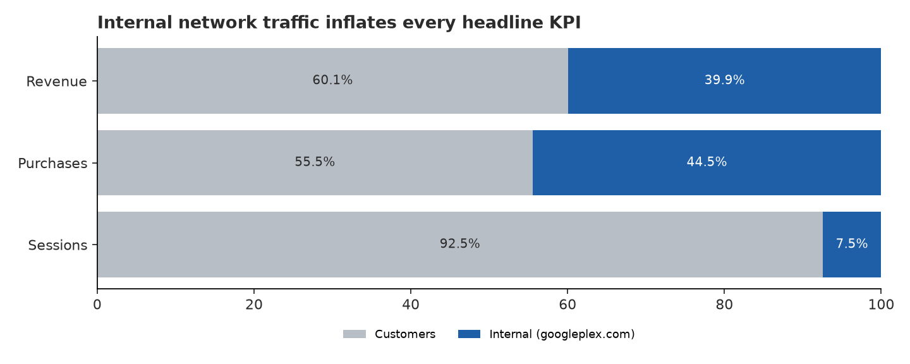
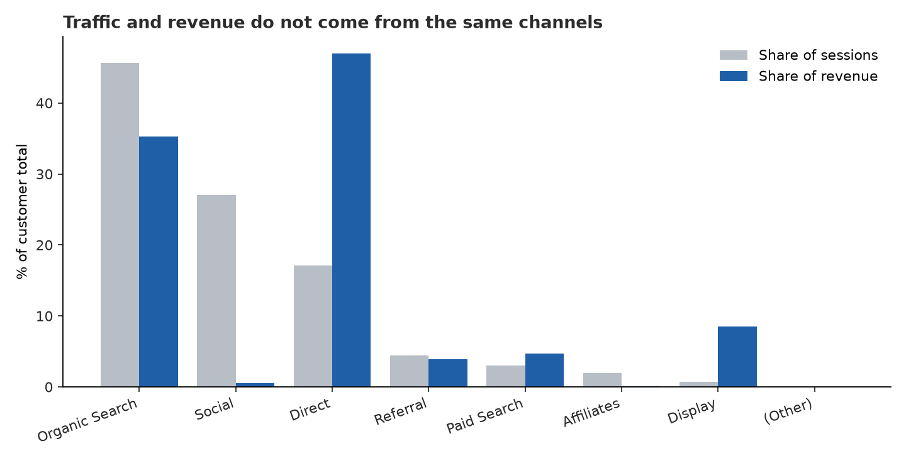
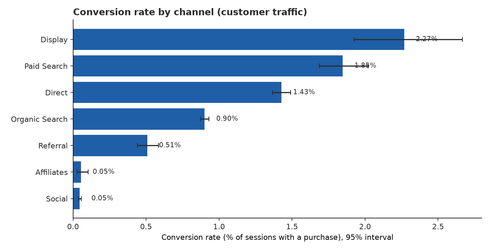
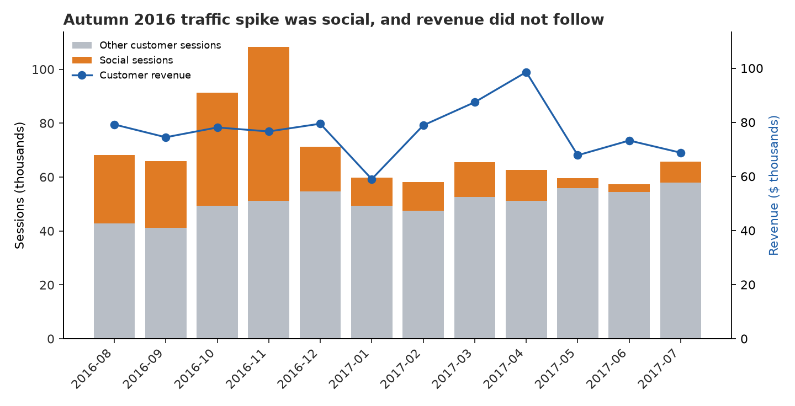
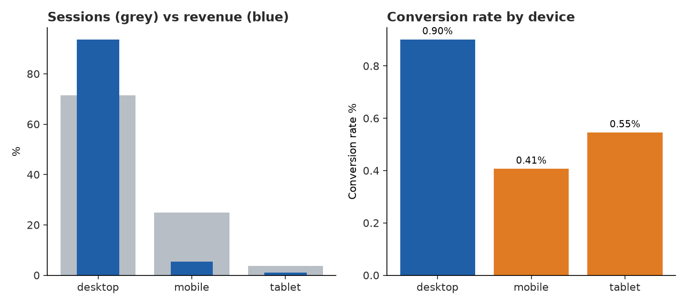
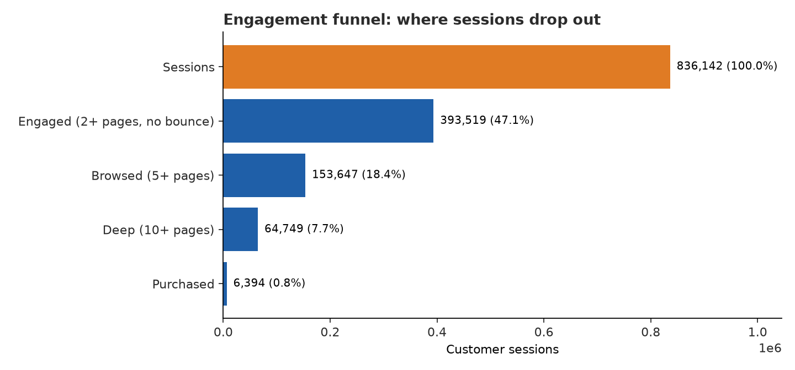

# Google Merchandise Store: Website Analytics

**Where does the store's traffic come from, which of it actually buys, and what should change?**

A year of Google Analytics sessions from the Google Merchandise Store (Google's own online shop
for branded clothing and accessories), analysed the way a digital analytics team would for a
monthly business review: define the KPIs, clean out the traffic that distorts them, break
performance down by channel, device and visitor type, and turn the findings into a short list
of actions. Deliverables are an Excel KPI workbook and a 12-slide insights deck.

## The answer in five lines

1. **Google's internal network inflates the numbers.** Sessions referred from googleplex.com, Google's
   corporate network (most likely staff), are 7.5% of traffic but 44.5% of purchases and 39.9% of revenue.
   Taken out, the store's real customer conversion rate is **0.76%**, not the 1.27% the unfiltered data shows.
2. **Mobile browses but does not buy.** Mobile is 25.0% of customer sessions and 5.4% of revenue.
   Mobile visitors view as many pages as desktop visitors and bounce no more often, yet convert **2.2x** less.
3. **The autumn 2016 traffic spike was YouTube, and it sold nothing.** Social reached 57,218 sessions
   in November 2016; YouTube sent 212,602 sessions over the year and 11 purchases.
4. **Return visits carry the business.** Returning visitors are 19.5% of sessions and **73.0%** of revenue.
5. **Direct and organic search earn the money.** Direct is 17.1% of sessions and 47.0% of revenue.

## Deliverables

| File | What it is |
|---|---|
| `reports/GA_Store_KPI_Dashboard.xlsx` | Excel workbook: a dashboard sheet with KPI tiles and native charts, plus Channels, Devices, Visitor type, Countries, Monthly, Traffic source and Internal vs customers sheets. Every rate is a formula over raw counts, so any cell can be traced. |
| `reports/GA_Store_Insights.pptx` | 12-slide deck for a senior audience: summary, KPI snapshot, five findings with charts, recommendations, appendix on data and definitions. |
| `sql/kpis.sql` | All KPI queries, one named block per table, run with DuckDB. |
| `reports/tables/*.csv`, `reports/results.json` | Every number quoted here and in the deck. |

## The data

The training file of Kaggle's *Google Analytics Customer Revenue Prediction* dataset: the store's
real GA export, one row per session, **903,653 sessions x 55 fields** (traffic source,
device, geography, and session totals such as pageviews, bounces and transaction revenue), from
1 Aug 2016 to 1 Aug 2017, covering 714,167 visitors. 21 of the fields are used.

Cleaning decisions, all in `src/load.py`:

| Issue | Rows | Decision |
|---|---|---|
| Revenue stored in micro-units | all | divided by 1,000,000 to get US dollars |
| Session ID on two dates | 898 | visits that crossed midnight, which GA splits into two sessions; kept as GA counts them |
| Missing pageviews | 100 | set to 0 |
| Bounces and new-visit flags blank when false | most rows | blank read as 0 |
| Google's internal network (googleplex.com referrals) | 67,511 | flagged and reported separately from customers |
| 1 Aug 2017 is a single day | 1 day | left out of the monthly trend |

**KPI definitions.** Conversion rate = sessions with revenue / sessions. The export has no order
count, so one converting session is treated as one order. Bounce rate = single-interaction sessions
/ sessions. Revenue per session = revenue / sessions.

## Finding 1: internal traffic distorts every headline KPI

| KPI | All traffic | Customers | Internal (googleplex.com) |
|---|---|---|---|
| Sessions | 903,653 | 836,142 | 67,511 |
| Purchases | 11,515 | 6,394 | 5,121 |
| Conversion rate | 1.27% | 0.76% | 7.59% |
| Revenue | $1,540,071 | $924,928 | $615,144 |
| Bounce rate | 49.9% | 52.7% | |
| Pages per session | 3.85 | 3.47 | |

Internal sessions convert at 10x the customer rate. Left in, they make the store look far
better at selling to the public than it is, and they hide how outside visitors behave. Only
googleplex.com is flagged: other google.com referrers (Gmail, Sites, Groups) are used by outside
people too, so they stay in the customer numbers. Everything below is customer traffic only.



## Finding 2: channels that bring traffic are not the ones that earn

| Channel | Sessions | Share | Bounce | Pages / session | Conversion | Share of revenue | Revenue / session |
|---|---|---|---|---|---|---|---|
| Organic Search | 381,561 | 45.6% | 48.3% | 4.11 | 0.90% | 35.3% | $0.86 |
| Social | 226,117 | 27.0% | 65.2% | 1.76 | 0.05% | 0.5% | $0.02 |
| Direct | 143,026 | 17.1% | 49.6% | 4.09 | 1.43% | 47.0% | $3.04 |
| Referral | 37,327 | 4.5% | 46.6% | 3.56 | 0.51% | 3.9% | $0.97 |
| Paid Search | 25,326 | 3.0% | 38.0% | 5.37 | 1.85% | 4.7% | $1.72 |
| Affiliates | 16,403 | 2.0% | 53.0% | 2.89 | 0.05% | 0.1% | $0.04 |
| Display | 6,262 | 0.7% | 35.9% | 5.46 | 2.27% | 8.5% | $12.51 |



- Direct visitors, people who type the address or use a bookmark, are the most valuable traffic.
- Paid search converts at 1.85% on only 3.0% of sessions, the clearest channel to test more budget on.
- Display looks like the best channel per session, but 98.2% of its revenue comes from one ad source
  (DoubleClick, `dfa`) and a single order is 29.5% of it. That is too few orders to act on.
- The US is 36.2% of customer sessions and 92.8% of revenue.



## Finding 3: the autumn 2016 spike was social, and revenue did not follow

Social sessions peaked at 57,218 in November 2016 and fell to an average of 4,763 a
month by May to July 2017. YouTube was 94.0% of all social sessions. Social traffic bounces
65.2% of the time; over the year it was 27.0% of customer sessions and 0.5% of revenue.
A dashboard that reports sessions would have shown autumn 2016 as a growth period. It was not.



## Finding 4: mobile visitors are interested, but do not buy

| Device | Sessions | Share | Bounce | Pages / session | Conversion | Share of revenue |
|---|---|---|---|---|---|---|
| desktop | 597,087 | 71.4% | 53.1% | 3.46 | 0.90% | 93.6% |
| mobile | 208,622 | 25.0% | 52.0% | 3.42 | 0.41% | 5.4% |
| tablet | 30,433 | 3.6% | 49.6% | 4.01 | 0.55% | 1.0% |

Desktop converts 2.2x better than mobile (two-proportion z = 22.2). The obvious objection is
channel mix: maybe mobile traffic simply comes from weaker channels. It does not explain it. Inside
each channel with enough purchases on both devices (Direct, Organic Search, Paid Search), desktop still converts
2.6x to 4.6x better. Because mobile visitors browse just as deeply, the drop is most
likely in the mobile cart and checkout, which is where testing should start.



## Finding 5: most buyers come back before they buy

Returning visitors convert at 2.10% against 0.44% for first visits (4.8x), and bring
73.0% of revenue from 19.5% of sessions. A first-visit conversion rate therefore undervalues
acquisition channels: their visitors often buy on a later visit.

## Engagement depth and funnel

| Pages in session | Share of sessions | Conversion | Share of purchases |
|---|---|---|---|
| 1 page | 52.9% | 0.00% | 0.0% |
| 2-3 pages | 24.0% | 0.00% | 0.1% |
| 4-9 pages | 15.3% | 0.12% | 2.5% |
| 10-19 pages | 5.3% | 5.20% | 36.3% |
| 20+ pages | 2.4% | 19.45% | 61.1% |

52.9% of sessions end after one page, and 97.4% of purchases happen in sessions of 10 or
more pages. Part of that is mechanical, since the cart and checkout are pages themselves, so more
pageviews is not a goal by itself. The one-page exits are the actionable part: a landing page problem.

Funnel by depth: 836,142 sessions, 393,519 engaged (2+ pages), 153,647 browsed 5+ pages,
64,749 reached 10+ pages, 6,394 purchased. The export has no add-to-cart or checkout-step
events, so the funnel is defined by depth rather than by shopping steps.



Customer order values: median $43.98, 90th percentile $298.27, largest $23,129.50.

## Recommendations

1. **Filter internal traffic.** Create a GA view or segment without googleplex.com referrals and report
   customers and staff separately. Real conversion is 0.76%.
2. **Test a shorter mobile checkout.** Mobile is 25.0% of sessions; the conversion gap holds within channels.
3. **Measure social on engagement and assisted conversions,** not sessions, so a YouTube spike is not read as growth.
4. **Bring first-time visitors back** with email sign-up and remarketing; returning visits convert 4.8x better.
5. **Scale paid search in steps,** watching cost per order, since it converts at 1.85% on a small share of traffic.

## How to run

```bash
python -m venv .venv && source .venv/bin/activate
pip install -r requirements.txt
kaggle datasets download colinpearse/ga-analytics-with-json-columns -f newtrain.csv -p data/raw --unzip
cd src && python run_all.py
pytest -q ../tests
```

`newtrain.csv` is the competition's `train.csv` with its JSON columns flattened (same 903,653
sessions). `run_all.py` rebuilds the parquet file, every table and figure, the Excel workbook, the deck
and this README from `reports/README_template.md`.

## Limits

- One converting session is counted as one order; the export has no transaction count.
- Session-level data only: no page paths, product views or checkout steps, so funnel stages are depth based.
- Display and some country results rest on a handful of large orders and should not drive budget alone.
- Internal traffic is identified by referrer, so staff who arrive directly or through search are still counted as customers;
  the internal share above is a lower bound.
